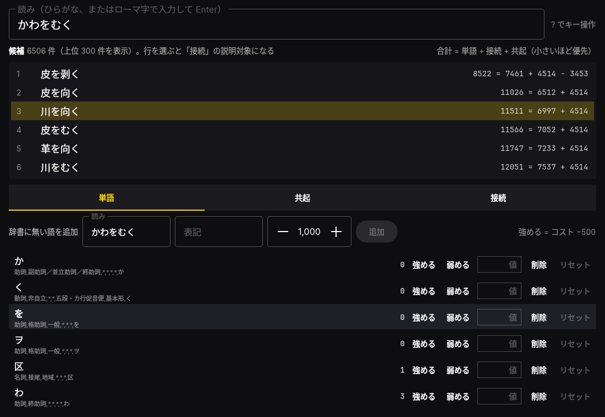

# vimeu-tune

vimeu の調整ウィンドウの Linux 版。単語・共起・接続のコストを編集すると、その場で変換し直した結果が出る。
編集はすぐにユーザー辞書（`~/.local/share/vimeu/`）へ保存され、入力中の vimeu（fcitx5）にも反映される。



各ペインの意味は、リポジトリ直下の README「変換の調整」と同じ。設計は DESIGN.md §8.6。

## 起動

- 入力中に Control+;、または入力メソッドのメニューの「調整...」。入力中の読みが入った状態で開く
- `vimeu-tune [--reading よみ]`。すでに開いていれば、そのウィンドウに読みを渡す
- `vimeu-tune state --reading よみ`：画面を出さずに状態を JSON で出力する

## キー操作

| キー | 動作 |
|---|---|
| `/` `Ctrl+L` | 読みの入力欄へ移る |
| `Enter` | 読みを変換し直す（ひらがなでもローマ字でもよい） |
| `J` `K` `↓` `↑` | 候補を選ぶ（「接続」ペインの説明対象になる） |
| `Ctrl+1` `Ctrl+2` `Ctrl+3` | 単語 / 共起 / 接続 |
| `?` | キー操作の一覧 |
| `Q` `Ctrl+Q` | 終了 |

## 開発

```sh
bin/build    # build/vimeu-tune（先にリポジトリ直下で swift build -c release --product vimeu）
bin/test     # Qt Test を画面外で実行する
```
